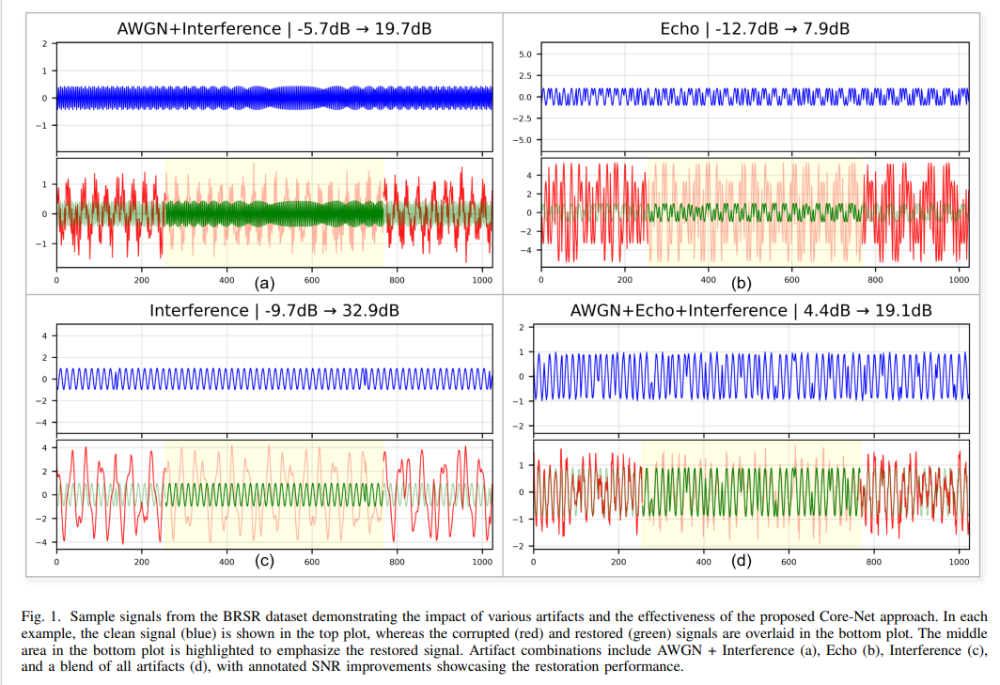
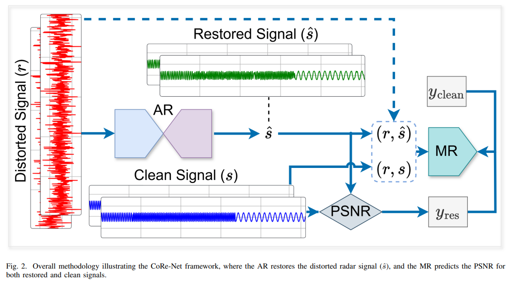
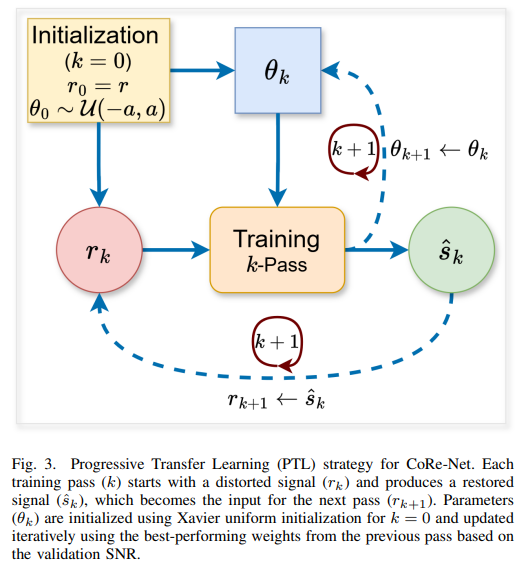
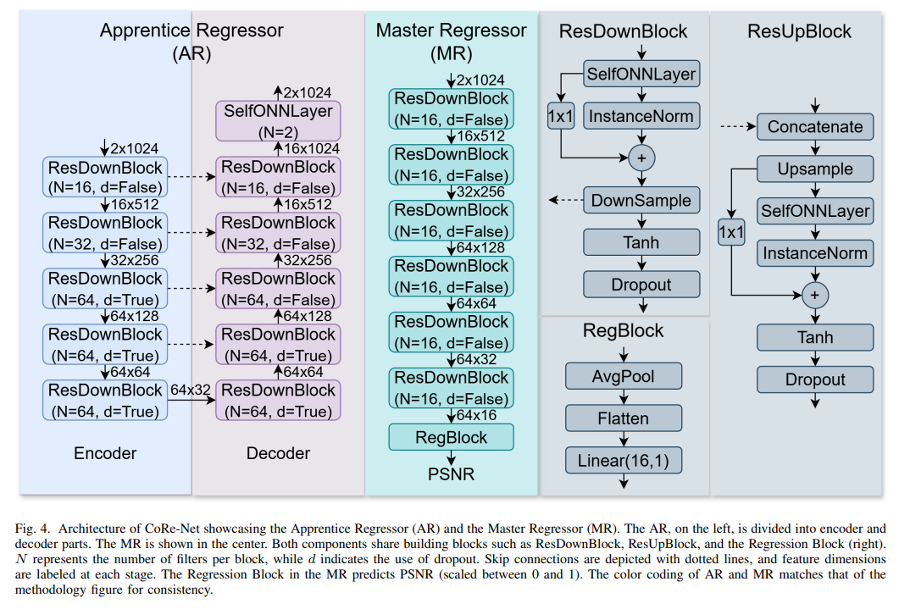
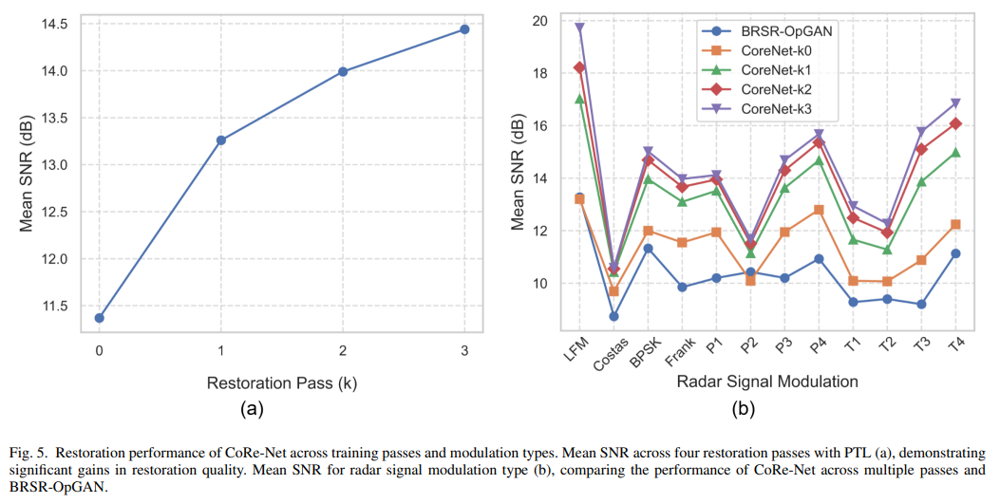
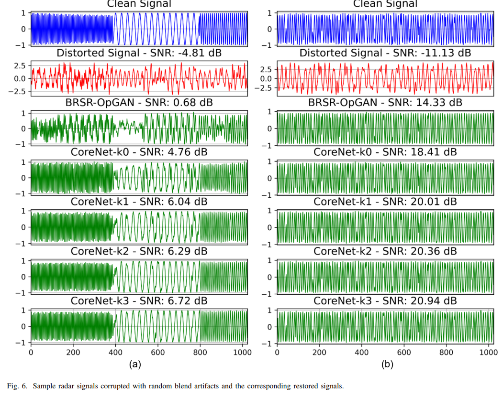

# CoRe-Net: Collaborative Regression Network + Gradient Transfer Learning, Refreshing the Benchmark for Blind Radar Signal Recovery Performance[with Python code]

CoRe-Net: Collaborative Regression Network with Gradient Transfer Learning, Updating the Benchmark for Blind Radar Signal Recovery
Recently, a research team from the University of Tampere in Finland, Qatar University, and Ankara Medipol University in Turkey jointly published their latest research findings, introducing a novel network architecture for blind radar signal recovery - the Co-Operational Regressor Network (CoRe-Net). This method replaces the traditional GAN's adversarial training mechanism with a collaborative learning paradigm, combined with gradient transfer learning to achieve multi-round iteration optimization. It comprehensively surpasses the previous optimal model BRSR-OpGAN on the standard BRSR dataset, establishing a new performance benchmark in the field of blind radar signal recovery.
Research Background: Challenges in Radar Signal Recovery in Complex Electromagnetic Environments
Radar signal recovery is a core component in enhancing the detection precision and reliability of radar systems. It is crucial in meteorological forecasting, target tracking, vehicle-mounted radar safety, especially in electronic warfare (EW) scenarios. Electronic warfare receivers often operate in wideband and high-noise environments, where low signal-to-noise ratio (SNR) severely limits tasks such as Doppler Offset (DOA) measurement and modulation recognition — reliable DOA measurement typically requires an SNR above 18dB, while achieving a 90% detection probability and a 10⁻⁶ false alarm probability for non-cluttered target signals requires an SNR at least 13dB.
As the electromagnetic environment becomes increasingly complex, real radar signals are contaminated by additive Gaussian white noise (AWGN), echoes, adjacent channel interference, and even intentional interference, with interference types, intensity, and duration exhibiting strong randomness. Traditional recovery methods are mostly designed for single distortion type and fixed SNR scenarios, significantly degrading performance in real complex environments.
In recent years, deep learning methods represented by OpGAN have achieved the current state-of-the-art performance. However, GAN-based methods based on adversarial training inherently have shortcomings such as training instability, mode collapse, and limited iterative optimization capabilities. How to improve training stability and recovery accuracy while ensuring blind restoration capability has become a pressing issue in the field.

II. Core Method: Double Innovation of Collaborative Learning + Gradual Transfer
1. The overall architecture of CoRe-Net completely abandons the traditional GAN "generator - discriminator" adversarial framework, instead adopting a collaborative learning architecture with an Apprentice Regressor (AR) and a Master Regressor (MR). They work in tandem, similar to the "student solving problems + teacher providing feedback" teaching model.

The Apprentice Regressor (AR): It adopts an encoder-decoder structure, consisting of five residual downsampling blocks and five residual upsampling blocks, embedded with one 1D Self-ONN layer. It inputs polluted radar signals directly outputting clean signals after restoration. It possesses both autonomous learning and assistive learning capabilities.

The Master Regressor (MR): As a specialized quality assessor, it consists of six residual downsampling blocks plus a regression head. It inputs raw distorted signals and pairs of restored / clean signals, outputting normalized PSNR scores to quantify the quality of restoration, providing continuous, task-related feedback signals for AR.
2. The collaborative training mechanism CoRe-Net adopts an alternating iteration strategy for collaborative optimization. The training process is divided into two steps that are cyclically executed:
AR Parameter Update: Fix MR parameters and optimize the total loss function of AR. The loss is composed of three parts weighted by: fidelity loss (ensuring that the MR score for the restored signal is as close to the full score of the clean signal), temporal loss (minimizing the temporal error between the restored signal and the clean signal), and spectral loss (minimizing the error in the spectral features of both signals), while ensuring the accuracy of the time-domain waveform and spectral structure of the signal.
MR Parameter Update: Fix AR parameters and optimize MR evaluation precision, enabling it to accurately distinguish between clean signals and different quality restored signals, outputting more reliable quality scores.
This regression-based continuous feedback replaces the binary discrimination of GAN, fundamentally avoiding issues such as mode collapse and training oscillations, achieving more stable convergence and higher maximum recovery quality.
Progressive Transfer Learning Multi-Round Optimization: To further explore the recovery potential, the research team proposed a progressive transfer learning (PTL) paradigm, which achieves iterative refinement of signals through a cascading multi-round CoRe-Net:
The first round of network training uses random initialization, outputting an initial restored signal;
In the second and subsequent rounds, each round takes the restored result from the previous round as input, and the network parameters directly inherit the model weights with the best performance on the validation set from the previous round, continuing to fine-tune training based on this basis.
This "input progressive purification + parameter knowledge inheritance" mechanism allows each round to specifically repair residual distortion from the previous round, while avoiding the cost of starting from scratch, achieving steady performance stacking.
Experimental Verification: Performance and Efficiency Breakthroughs The research team conducted comprehensive verification on the standard \\\u003cbr\\\u003eBlind Radar Signal Recovery Dataset (BRSR). This dataset contains 85,800 pairs of clean - contaminated signals, covering single and combined distortions of AWGN, echoes, and interference, with SNR ranging from -14dB to 10dB, fully simulating real complex electromagnetic environments.
Under the same network parameters and fair experimental settings, the average SNR performance of various methods is as follows:
Recovery method  
Average SNR (dB)  
Original polluted signal  
-1.94  
VMD-LMD-WT traditional decomposition method  
3.36  
CNN-GAN  
9.04  
BRSR-OpGAN (previously optimal)  
10.30  
CoRe-Net (single round) 11.37  
Single round CoRe-Net surpassed the previously optimal BRSR-OpGAN, with an average SNR improvement exceeding 1dB. After four rounds of progressive transfer learning, CoRe-Net's average recovery SNR broke through 14dB, an increase of about 3dB compared to the first round, and each round brought stable performance gains. The effectiveness was particularly significant on complex modulation signals such as LFM and T4.
In terms of efficiency, thanks to the compact Self-ONN architecture, the parameter size and inference delay of single round CoRe-Net are almost identical to those of BRSR-OpGAN: total parameters around 358K, a single batch GPU inference only takes about 0.04ms, even for three-round cascading restoration, it fully meets real-time processing requirements and can be deployed on resource-constrained embedded platforms.
Conclusion and prospects core conclusion 1  
The collaborative learning paradigm can completely replace adversarial training to achieve high-quality blind signal recovery, with more stable training and higher performance limits;  
2  
CoRe-Net set new SOTA records on the BRSR benchmark, with a single-round SNR surpassing OpGAN by more than 1dB, and after multiple rounds of PTL, the advantage expanded to 3dB;  
3  
The model is lightweight and efficient, balancing performance and real-timeness, with engineering implementation value.
The Future Directions Research Team stated that they would expand their work in three directions: integrating signal classification tasks into the restoration framework to achieve a "restoration-classification" bidirectional promotion; exploring a hybrid paradigm of collaborative learning and adversarial learning, combining the advantages of both; and researching an adaptive PTL strategy to achieve optimal balance between performance gains and computational costs while expanding the model's adaptability to more signal types and more complex distortion scenarios.
This work not only provides a new technical roadmap for the field of radar signal restoration but also its "cooperative regression + progressive transfer" approach can be extended to other one-dimensional blind signal restoration tasks such as audio and electrocardiogram, showing broad application prospects.

## Images

<!-- PAYMENT_BLOCK -->

## Get this dataset

- Payment link (Stripe): [Buy now](https://buy.stripe.com/3cs8yP7sY87d0vu9AB)
- Payment QR code: 

<!-- /PAYMENT_BLOCK -->
